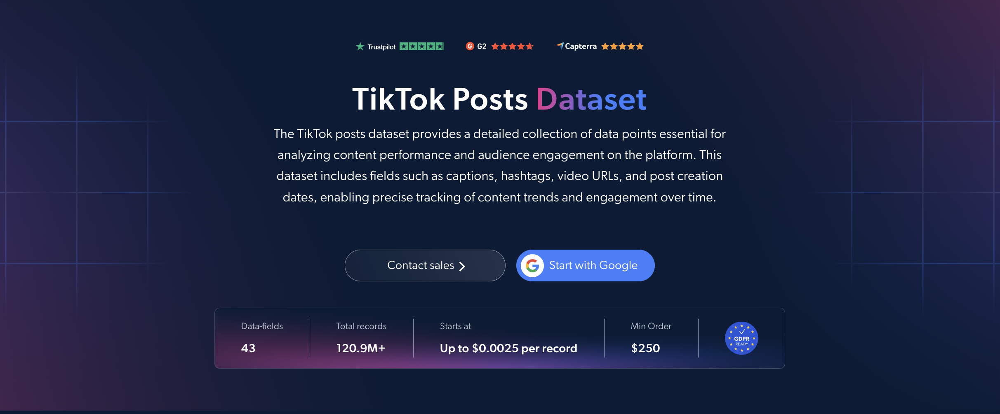

# TikTok 帖子数据集样本

<h2>包含 1000 条 TikTok 帖子的示例数据集</h2>

<a href="https://www.bright.cn/products/datasets/tiktok/posts">
   
</a>

包含 1000 条公开帖子的 TikTok 数据集样本。该数据集使用 <b>Bright Data API</b> 提取。

<h2>数据集中包含的部分数据点：</h2>

* ```url```：TikTok 帖子的 URL
* ```post_id```：每条帖子的唯一标识符
* ```description```：帖子文案
* ```create_time```：帖子的创建日期和时间
* ```post_type```：帖子类型，例如视频或图片
* ```video_duration```：视频时长
* ```hashtags```：帖子中使用的话题标签
* ```play_count```：视频播放次数
* ```digg_count```：点赞数
* ```comment_count```：评论数
* ```num_share_count```：分享次数
* ```collect_count```：帖子收藏次数
* ```original_sound```：帖子中使用的声音
* ```music```：视频中所用音乐的详细信息
* ```region```：视频的来源国家/地区
* ```commerce_info```：帖子是否包含购物、推广或联盟营销内容
* ```profile_username```：发布内容的账号用户名
* ```profile_url```：账号 TikTok 个人主页的 URL
* ```profile_followers```：账号的粉丝数
* ```is_verified```：账号是否经过认证
* ```preview_image```：帖子预览图
* ```carousel_images```：轮播类型帖子中的图片
* ```subtitle_info```：视频的字幕详细信息

以及更多内容。

这是“TikTok 帖子（公开数据）”数据集的示例子集，该完整数据集包含超过 <b>120,900,000 条帖子</b>。

可用的数据集文件格式：<b>JSON、NDJSON、JSON Lines、CSV、XLSX 或 Parquet。还可选择将文件压缩为 .gz 格式</b>。

数据集交付方式选项：<b>电子邮件、API 下载、Webhook、Amazon S3、Google Cloud Storage、Google Cloud Pub/Sub、Microsoft Azure、Snowflake、SFTP</b>。

更新频率：<b>单次、每日、每周、每月、每季度、每半年或自定义周期</b>。

可在提取的数据点基础上添加数据增强：<b>按需求提供。</b>

<b>[获取完整的 TikTok 帖子数据集](https://www.bright.cn/products/datasets/tiktok/posts)</b>。

<a href="https://www.bright.cn/products/datasets/tiktok/posts">
</a>

<h2>TikTok 帖子数据集有哪些使用场景？</h2>

<h3>1. 网红发掘</h3>
品牌使用 TikTok 帖子数据集寻找内容表现出色的创作者。他们不只关注粉丝数，还会通过播放量、点赞数、分享次数、收藏次数和评论数评估真实触达效果，从而识别出帖子能持续带来互动的创作者。

<h3>2. 趋势、话题标签和声音追踪</h3>
营销人员会追踪哪些文案、话题标签、声音和音乐曲目正逐渐流行。尽早发现新兴趋势有助于规划内容日历，并在音频热度仍处于上升期时为营销活动选择合适的音频。

<h3>3. 竞争情报</h3>
公司通过比较竞争对手各 TikTok 帖子的播放量、点赞数、分享次数、收藏次数和评论数，分析其内容表现。这有助于发现反复出现的主题、发帖频率，以及哪些内容能引起共同目标受众的共鸣，从而优化内容和品牌定位策略。

<h2>面向学术研究人员和 NGO 免费开放网页爬虫工具和数据集</h2>

Bright Initiative 为顶尖院系和学术研究人员，以及推动各类环境与社会公益事业的 NGO 和 NPO，提供 Bright Data 的 <b>[网页爬虫工具 API](https://www.bright.cn/products/web-scraper)</b> 和 <b>[即用型数据集](https://www.bright.cn/products/datasets)</b>。你可以在<b>[此处](https://brightinitiative.com)</b>提交申请。
